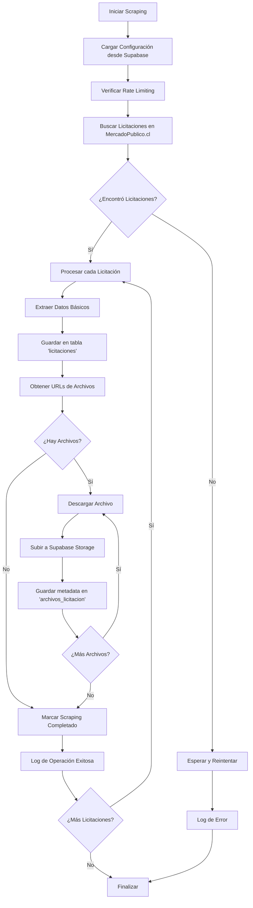

# Mercado Publico Scraper

## Flujo Principal

## API Endpoints

- `GET /api/licitaciones` - Listar licitaciones con filtros
- `GET /api/licitaciones/:id` - Obtener licitación específica
- `GET /api/licitaciones/:id/archivos` - Listar archivos de una licitación
- `POST /api/scraping/iniciar` - Iniciar proceso de scraping
- `GET /api/scraping/status` - Estado actual del scraping
- `GET /api/configuracion` - Obtener configuración actual
- `PUT /api/configuracion` - Actualizar configuración
